GEOMETOR • casey
================

**Visit the Online Archive:** https://geometor.github.io/casey/

**John Casey • A Sequel to the First Six Books of the Elements of Euclid • semantic digital archive**

Mission
-------

``geometor/casey`` is part of the interconnected `GEOMETOR <https://geometor.com>`_ semantic digital archive. It provides a multi-track Book Codex and exact symbolic algebraic engine for John Casey's landmark *Sequel to Euclid*. The archive bridges classical Euclidean geometry with modern circle, projective, and triangle geometry—liberating Casey's theorems from isolated print bounds into addressable semantic units, calibrated theme-adaptive vector diagrams, primary-source folio provenance, and exact symbolic algebra across the GEOMETOR corpus.

Books in This Archive
---------------------

- `A Sequel to the First Six Books of the Elements of Euclid <https://geometor.github.io/casey/sequel_to_euclid/>`_ — Containing an Easy Introduction to Modern Geometry, with Numerous Examples (1888), covering circle powers, inversion, coaxials, poles and polars, and the modern geometry of the triangle.

Repository Contents
-------------------

- ``docsrc/`` — Multi-track Book Codex, apparatus, and Sphinx documentation compiled by `PHOTON publish <https://github.com/photon-platform/publish>`_.
- ``resources/`` — Archival scan page references, apparatus registries (persons, citations, glossary), and concordance mappings.
- ``src/geometor/casey/`` — Python modules for exact symbolic invariants, Feuerbach theorem proofs, coaxial pencils, poles and polars, and Brocard geometry.

Local Build & Verification
--------------------------

.. code-block:: bash

   publish build
   uv run --no-sync pytest

Part of the GEOMETOR Knowledge Archive
--------------------------------------

Explore all **74 Book Codices** and **11 Mathematical Catalogs** at https://geometor.com/books/.
