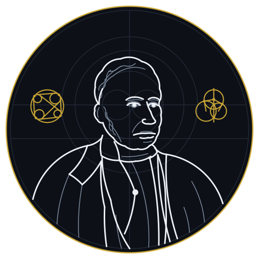

:site_title: John Casey

.. container:: author-overline

   semantic digital archive • the works of

==========
John Casey
==========

**John Casey** (1820–1891), Fellow of the Royal University of Ireland, wrote the essential bridge between classical Greek geometry and the nineteenth-century renaissance of circle and triangle geometry. His *Sequel to Euclid* gathers the radical axes, coaxal pencils, poles and polars, circular inversion, Casey's generalized Ptolemy theorem, and the Brocard–Lemoine–Tucker geometry of the triangle into a unified synthetic system.

Books in This Collection
------------------------

.. container:: home-book-hero

   .. container:: home-book-thumb plate-light

      .. image:: sequel_to_euclid/supplementary_chapter/0205.g1.png
         :alt: John Casey 1888 Lemoine Circle and Symmedian Point diagram (f. 0205)
         :target: sequel_to_euclid/index.html

   .. container:: home-book-body

      .. rubric:: Dublin University Press Series · 1888 / 1892 · 5 Books + Supplementary Chapter

      **A Sequel to the First Six Books of the Elements of Euclid** — The complete fifth edition (1888) and sixth-edition apparatus (1892), transcribed across **276 archival folios** with **39 cropped original plates**, **21 calibrated interactive vector diagrams**, and full commentary tracks.

      .. container:: home-actions

         * :doc:`Open the Sequel to Euclid → <sequel_to_euclid/index>`
         * :doc:`Supplementary Chapter (Triangle Geometry) → <sequel_to_euclid/supplementary_chapter/index>`
         * :doc:`Constructive Demos → <demos/index>`

Key Features
------------

.. container:: home-feature-grid

   .. container:: home-feature-card

      **Circle Power, Inversion & Coaxal Pencils**

      Follow Casey's systematic development of radical axes, Poncelet limiting points, poles and polars, and his celebrated orthogonal-inversion proof of Feuerbach's nine-point tangency.

   .. container:: home-feature-card

      **Modern Triangle Geometry (Brocard, Lemoine & Tucker)**

      Explore the Supplementary Chapter's complete treatment of isogonal conjugates, the symmedian point $X(6)$, Brocard points $\Omega, \Omega'$, and Lemoine–Tucker circles.

   .. container:: home-feature-card

      **Exact Symbolic ``geometor.model`` Verifications**

      Seven constructive demonstrations in :doc:`demos/index` verify Feuerbach tangency, coaxal pencils, harmonic ranges, and Brocard circles over exact Heronian coordinates $(15, 13, 14)$.

Reference & Project
-------------------

.. container:: home-columns

   .. container:: home-col

      .. rubric:: Scholarly Apparatus

      * :doc:`People <sequel_to_euclid/people/index>` — Profiles of John Casey, Patrick Dowling, Karl Feuerbach, Émile Lemoine, Henri Brocard, and Jean-Victor Poncelet
      * :doc:`Bibliography <sequel_to_euclid/bibliography>` — 1888 and 1892 Dublin/London editions and primary nineteenth-century sources
      * :doc:`Concordance <sequel_to_euclid/concordance>` & :doc:`Glossary <sequel_to_euclid/glossary>` — Cross-corpus mapping to Euclid, Altshiller-Court, ETC, and Pappus

   .. container:: home-col

      .. rubric:: About This Project

      * :doc:`About <about/index>` — Editorial scope, symbolic invariants, and archival provenance
      * :doc:`Using This Edition <usage/index>` — Track switching, folio links, and collection navigation
      * :doc:`Log <log/index>` & :doc:`Modules <modules/index>` — Development history and Python API reference

.. toctree::
   :maxdepth: 2
   :hidden:

   sequel_to_euclid/index
   sequel_to_euclid/people/index
   sequel_to_euclid/bibliography
   about/index
   usage/index
   demos/index
   log/index
   modules/index
